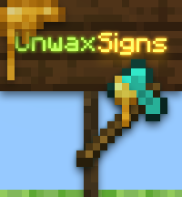

<!-- PROJECT HEADER -->
<br />
<div align="center">
  <a href="https://github.com/jDanek/papermc-unwaxsigns">
    
  </a>

  <h1 align="center">UnwaxSigns</h1>

  <p align="center">
    Bring back the "wax off" - let players unwax signs with an axe, on your terms.
    <br />
    <a href="https://github.com/jDanek/papermc-unwaxsigns/issues"><strong>Report Bug</strong></a> ·
    <a href="https://github.com/jDanek/papermc-unwaxsigns/issues"><strong>Request Feature</strong></a>
  </p>
</div>

<!-- BADGES -->
<div align="center">

[](https://papermc.io)
[](https://adoptium.net)
[](https://bstats.org/plugin/bukkit/UnwaxSigns/32556)
[](LICENSE)

<!-- Once published, swap in the live dynamic badges:
[](https://modrinth.com/plugin/unwaxsigns)
[](https://hangar.papermc.io/jDanek/UnwaxSigns)
-->

</div>

---

## 📌 About

Minecraft's wax mechanic locks a sign for good - with no vanilla way back, short of breaking and replacing it. **UnwaxSigns** fixes that: right-click a waxed sign with an axe (or whatever tool you configure) and the wax comes right off, editable again, complete with sound and particle feedback.

It's built to disappear into your server: works out of the box with zero configuration, but every rule - which tools count, what it costs, who can bypass what, how it sounds and looks - is yours to tune.

### ✨ Key Features

* 🪓 **Flexible tool detection** - item tags (`#axes`), an explicit material list, or both combined, with exclusions (e.g. no `wooden_axe`, to stay out of WorldEdit's way).
* 🏷️ **Custom tool requirements** - require a specific display name and/or enchantment before a tool works.
* 💰 **Vault economy** - charge per unwax, with a dedicated bypass permission for VIPs.
* 🛡️ **Protection-plugin aware** - respects WorldGuard, GriefPrevention, and similar plugins with no hard dependency.
* 🎵 **Immersive feedback** - fully configurable sounds and particles for success and failure, world- or player-only.
* ⏱️ **Smart cooldowns** - independent per-player and per-block cooldowns, auto-cleaned in the background.
* 🌍 **Localization** - MiniMessage-formatted translations; English and Czech included, more just a YAML file away.
* 🧩 **Built for other plugins** - five custom events let other developers extend or restrict the unwax flow.
* 📦 **Zero-config start** - sensible defaults mean it just works the moment you drop it in.

---

## 📥 Where to Download

For your server's safety, only download UnwaxSigns from official channels:


* **[Hangar](https://hangar.papermc.io/jDanek/UnwaxSigns)** - official PaperMC platform
* **[Modrinth](https://modrinth.com/plugin/unwaxsigns)**
* **[CurseForge](https://www.curseforge.com/minecraft/bukkit-plugins/unwaxsigns)**
* **[GitHub Releases](https://github.com/jDanek/papermc-unwaxsigns/releases)** - source and dev builds

> Listings go live shortly after the first release - until then, build from source (see below).

---

## 🛠️ Installation

1. Download `UnwaxSigns.jar` from one of the platforms above.
2. Drop it into your server's `plugins/` folder.
3. Start or restart the server - `config.yml`, `effects.yml`, and `translations/` are generated automatically.
4. Tweak the config to your liking, then apply changes with **`/unwaxsigns reload`**.

> ⚠️ **Don't use `/reload` or `/paper reload`** to apply UnwaxSigns config changes - always use `/unwaxsigns reload` instead, to make sure everything (config, effects, translations) reloads cleanly.

---

## 🤝 Compatibility

UnwaxSigns doesn't hook into any specific permission or protection plugin's API - instead it builds on the standard Bukkit mechanics almost every plugin in those categories already respects. That means it works out of the box with your existing setup, whatever it is, with nothing to configure per-plugin:

* **Permission plugins** - permissions are checked with the standard `sender.hasPermission(...)` call, so `unwaxsigns.use` and the `unwaxsigns.bypass.*` nodes work with any permission plugin (LuckPerms, PermissionsEx, GroupManager, or plain `ops.json`/`permissions.yml`) exactly the way you'd expect - per-world, per-group, per-track, however your plugin of choice supports it.
* **Region/claim-protection plugins** - before unwaxing, UnwaxSigns fires a synthetic `BlockBreakEvent` for the sign; if a protection plugin cancels that event, the unwax is denied. This covers WorldGuard, GriefPrevention, Lands, Towny, and any other plugin that listens for and cancels block-break events in protected areas - without a hard dependency on any of them. If this synthetic event ever conflicts with another listener (e.g. a stats or quest plugin reacting to block breaks), it can be turned off with `region-protection-check: false`.
* **Vault** *(soft-dependency)* - the one exception, since charging players requires talking to an actual economy provider. If Vault and a registered economy plugin are present, `cost-per-unwax` is charged per use and formatted through the Vault API. Without Vault, unwaxing is simply free.

---

## 💻 Commands & Permissions

<details>
<summary><b>Expand command &amp; permission table</b></summary>

| Command | Aliases | Description | Permission | Default |
|---|---|---|---|---|
| `/unwaxsigns` | `/unwaxsign`, `/uws` | Shows usage help | `unwaxsigns.admin` | op |
| `/unwaxsigns reload` | | Reloads config, effects, and translations | `unwaxsigns.admin` | op |

| Permission | Description | Default |
|---|---|---|
| `unwaxsigns.use` | Allows unwaxing signs | true |
| `unwaxsigns.admin` | Allows reloading the configuration | op |
| `unwaxsigns.bypass.name` | Bypasses the required custom tool name | op |
| `unwaxsigns.bypass.enchantment` | Bypasses the required enchantment | op |
| `unwaxsigns.bypass.cost` | Bypasses the economy cost | op |
| `unwaxsigns.bypass.cooldown` | Bypasses the unwax cooldown | op |

Permission checks can be disabled entirely with `use-permissions: false` in `config.yml`, letting every player use the feature regardless of nodes.

</details>

---

## ⚙️ Configuration

Full configuration lives in two well-commented files, generated on first start and always up to date in the repo itself:

* **[`config.yml`](src/main/resources/config.yml)** - permissions, notifications, cooldowns, drops, world restrictions, economy cost, tool detection, and tool requirements.
* **[`effects.yml`](src/main/resources/effects.yml)** - sounds and particles for successful and failed unwax attempts.

A few of the most-tweaked options, to give you a feel for it:

| Option | File | Default | What it does |
|---|---|---|---|
| `tool-settings.mode-type` | `config.yml` | `combi` | Whether allowed tools come from item tags (`tag`), an explicit list (`list`), or both (`combi`). |
| `settings.cost-per-unwax` | `config.yml` | `0.0` | Vault charge per unwax; `0.0` keeps it free. |
| `settings.region-protection-check` | `config.yml` | `true` | Respect WorldGuard/GriefPrevention/etc. via a synthetic `BlockBreakEvent`. |
| `settings.notification-type` | `config.yml` | `actionbar` | Where denial messages appear: `actionbar`, `chat`, or `none`. |
| `tool-restrictions.enchantment-required` | `config.yml` | `false` | Require a specific enchantment on the tool before it works. |
| `effects.success.sound` / `.particle` | `effects.yml` | `item.axe.scrape` / `WAX_OFF` | Feedback played when a sign is successfully unwaxed. |

### Tool detection modes

| Mode | Behavior |
|---|---|
| `tag` | Uses Minecraft item tags (e.g. `#axes`) from `tag-names`. Falls back to `#axes` if none are found and `use-axes-tag-fallback` is `true`. |
| `list` | Uses only the explicit material list under `allowed-items`. |
| `combi` | Starts from the tag set, then adds `allowed-items` on top - handy for including non-axe tools like `brush`. |

Items under `excluded-items` are always removed, regardless of mode.

### Translations

Language files live in [`translations/`](src/main/resources/translations) and use [MiniMessage](https://docs.advntr.dev/minimessage/format.html) formatting. English and Czech are bundled. To add one: copy `messages_en.yml` to `messages_<code>.yml`, translate it, set `settings.language` accordingly, and run `/unwaxsigns reload`.

---

## 🧩 Developer API

UnwaxSigns fires its own Bukkit events so other plugins can hook into the unwax flow:

| Event | Cancellable | Fires |
|---|---|---|
| `PlayerPreUnwaxSignEvent` | ✅ | Before any validation - cancel to override the whole flow. |
| `PlayerUnwaxedSignEvent` | ✅ | After validation passes, before the wax is removed. |
| `PlayerPostUnwaxSignEvent` | ❌ | After a sign is successfully unwaxed. |
| `PlayerUnwaxDenialEvent` | ❌ | On any denial, with a `DenialReason` (`SNEAKING_REQUIRED`, `NO_PERMISSION`, `COOLDOWN`, `WRONG_CUSTOM_NAME`, `WRONG_ENCHANTMENT`, `NOT_ENOUGH_MONEY`, `REGION_PROTECTED`, `CANCELLED_BY_PLUGIN`). |
| `SignUnwaxedDropEvent` | ✅ | Before a configured drop spawns - cancel or modify it. |

```java
@EventHandler
public void onUnwax(PlayerPostUnwaxSignEvent event) {
    Player player = event.getPlayer();
    Block sign = event.getBlock();
    // your logic here
}
```

For now, depend on the plugin jar directly and add `UnwaxSigns` as a `depend`/`softdepend` in your own `plugin.yml`; a standalone API artifact is planned.

---

## 📊 Metrics (bStats)

UnwaxSigns reports anonymous usage stats via [bStats](https://bstats.org/plugin/bukkit/UnwaxSigns/32556) - unwax counts, denial reasons, and similar aggregate data - to help guide development. Disable anytime in `plugins/bStats/config.yml`.

---

## 🔨 Building from Source

Built with **Gradle** (Kotlin DSL) and [Shadow](https://gradleup.com/shadow/):

```bash
git clone https://github.com/jDanek/papermc-unwaxsigns.git
cd UnwaxSigns
./gradlew shadowJar
```

The jar is output to `build/libs/UnwaxSigns-<version>-all.jar`. Only bStats is bundled and relocated into the plugin's own package; the Paper API and VaultAPI stay `compileOnly` and are provided by the server at runtime. Requires a JDK able to resolve a **Java 25** toolchain (Gradle auto-provisions one via the Foojay resolver if needed).

For quick manual testing against Paper 26.1.2:

```bash
./gradlew runServer
```

---

## 📄 License & Credits

Distributed under the **MIT License** - see [`LICENSE`](LICENSE) for the full text.

Built on the excellent [PaperMC](https://papermc.io) and [Kyori Adventure](https://github.com/KyoriPowered/adventure) APIs.

---

<div align="center">
  <sub>Built with ❤️ by <a href="https://github.com/jDanek">jDanek</a></sub>
</div>
